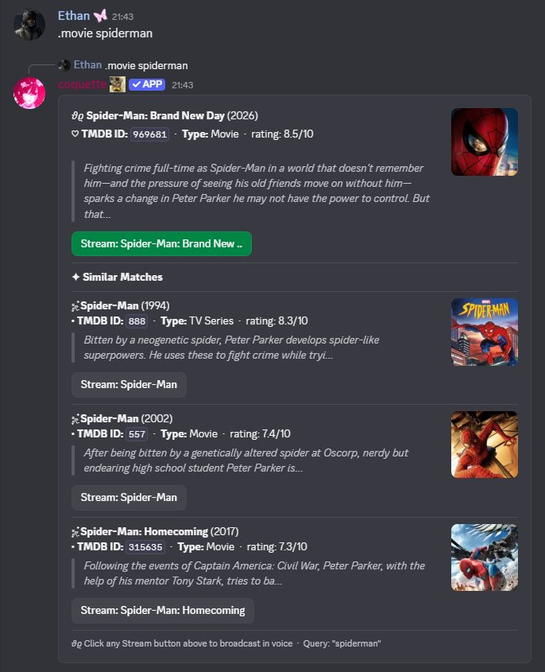
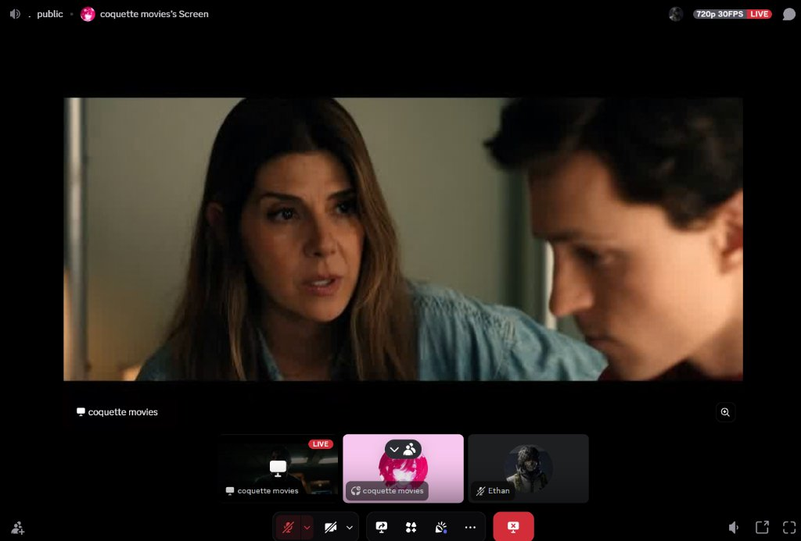

<div align="center">


# 𝜗𝜚 Discord Movie & Video Streamer

**♡ A high-performance, cross-platform Discord Media Streamer bot that broadcasts movies, TV series, and web videos directly into voice channels with 100% borderless fullscreen playback and minimal CPU utilization.**

*Built for Windows 10/11 & Linux VPS (Ubuntu/Debian x86_64 & ARM64)*


</div>

## ✦ Live Previews

<div align="center">

<table>
  <tr>
    <th width="50%" align="center">𝜗𝜚 Search & Stream Card (Components V2)</th>
    <th width="50%" align="center">✦ Live Playback in Voice Channel</th>
  </tr>
  <tr>
    <td align="center">
      
      <br>
      <sub>• Interactive TMDB movie cards with poster, rating, synopsis & 1-click Stream buttons</sub>
    </td>
    <td align="center">
      
      <br>
      <sub>• 100% borderless full-screen capture in Discord Voice & Video (720p/480p)</sub>
    </td>
  </tr>
</table>


</div>

## ╭── 𝜗𝜚 Core Features

- **♡ Discord Components V2 UI**: Modern interactive message cards with posters, release dates, ratings, overview, and one-click stream buttons for top and similar matches.
- **✦ 100% Borderless Fullscreen**: Launches Chromium in application kiosk mode with zero window borders, URL bars, or browser tabs. Automatically expands the HTML5 video element to fill the canvas.
- **⨾𓍢ִ໋ Voice Channel Auto-Detection**: Automatically detects which voice channel you are sitting in and joins it immediately, with a fallback to `.public`.
- **✧ Direct & Search Streaming**:
  - Direct TMDB numeric ID (`.stream 969681` or `.stream 1396`)
  - Direct video URLs (`.stream https://...`)
  - Title keyword search (`.movie inception` or `.stream avatar`)
- **ᝰ.ᐟ Featherlight CPU Footprint**:
  - Single-threaded rasterization & single-threaded FFmpeg encoding to prevent CPU contention on budget 1–2 vCPU VPS instances.
  - Freezes Discord Web background DOM elements and silences duplicate preview decoders.
- **✦ Rock-Solid Audio Sync**: WebRTC audio loopback capture on Windows, and PulseAudio virtual sink routing (`Virtual_Sink.monitor` -> `Virtual_Mic`) on Linux.


## ╭── ✧ Discord Bot Commands

| Command | Syntax Example | Description |
|:---|:---|:---|
| `.movie` | `.movie spiderman` | Searches TMDB and displays interactive cards with one-click **Stream** buttons. |
| `.stream` | `.stream 969681` | Streams directly by TMDB movie or TV series numeric ID. |
| `.stream` | `.stream <url>` | Streams any custom video link (YouTube, Cinejoy, HTML5 player). |
| `.stream` | `.stream breaking bad` | Searches for title and immediately streams the top match in voice. |
| `.stream stop` | `.stream stop` | Cleanly leaves voice channel, closes the browser instance, and frees system resources. |
| `.help` | `.help` | Displays the interactive Components V2 commands menu. |


## ╭── ⨾𓍢ִ໋ Quick Start: Windows (1-Click)

### 1. Prerequisites
- **Node.js v18+** installed on your system.
- (Optional) **FFmpeg** added to your system PATH.

### 2. Launch
- **First-Time Setup**: Double-click `setup_windows.bat`  
  *(Installs npm dependencies, Playwright Chromium, and initializes `.env`)*
- **Start Bot**: Double-click `start.bat`  
  *(Starts the Discord bot client. Users can run `.movie <query>` in any server channel)*
- **Direct Stream (No Bot)**: Double-click `run.bat`  
  *(Instantly launches browser streaming without waiting for chat commands)*


## ╭── ᝰ.ᐟ Quick Start: Linux VPS (Ubuntu / Debian)

Automated one-command setup for fresh Oracle Cloud, DigitalOcean, Hetzner, AWS, or Contabo VPS instances:

```bash
# 1. Clone repository
git clone https://github.com/akashsuu/Discord-movie-stream-bot.git /opt/discord-stream-bot
cd /opt/discord-stream-bot

# 2. Run automated VPS installer
bash setup_vps.sh
```

### What `setup_vps.sh` Configures Automatically:
- Installs Node.js LTS, FFmpeg, Xvfb virtual display, and PulseAudio.
- Creates and connects virtual audio loopback sinks (`Virtual_Sink` & `Virtual_Mic`).
- Installs project dependencies and Playwright Chromium binaries.
- Configures PM2 daemon management with automatic boot persistence and restart recovery.

### VPS Process Management:
```bash
pm2 status                          # View process status
pm2 logs discord-stream-bot        # View live output logs
pm2 restart discord-stream-bot     # Restart stream bot
pm2 stop discord-stream-bot        # Stop stream bot
bash monitor.sh -w                  # Real-time CPU, RAM & Stream monitor
```


## ╭── ✦ Environment Configuration (`.env`)

Copy `.env.example` to `.env` and fill in your Discord credentials:

```env
# Discord Application Bot Token (from Discord Developer Portal)
BOT_TOKEN=your_discord_bot_token_here

# User/Self Token (used by the browser engine to join voice and share screen)
USER_TOKEN=your_discord_user_token_here

# Target Server (Guild) & Default Voice Channel IDs
GUILD_ID=1474805625018913043
VOICE_CHANNEL_ID=1499087387320651919

# Command Prefix
PREFIX=.

# TMDB API Key (v3 authentication key)
TMDB_API_KEY=15d2ea6d0dc1d476efbca3eba2b9bbfb

# Optional: HTTP/HTTPS proxy URLs for TMDB (comma-separated, for regions where api.themoviedb.org is blocked)
TMDB_PROXIES=

# Display & Headless Mode (Set false for Discord tab capture and video decoding)
DISPLAY=:99
PULSE_SINK=Virtual_Sink
BROWSER_PATH=/usr/bin/chromium
HEADLESS=false
TAB_CAPTURE_KEYWORD=Stream
USER_DATA_DIR=./browser-profile
```


## ╭── ✧ Project Structure

```
Discord-movie-stream-bot/
├── assets/
│   ├── banner.gif          # Header aesthetic animation
│   ├── divider.gif         # Animated section line divider
│   ├── search_command.jpg  # Preview: .movie TMDB Components V2 card
│   └── streaming_in_vc.jpg # Preview: Voice channel borderless stream
├── commands/
│   ├── help.js             # .help Components V2 guide
│   ├── movie.js            # .movie TMDB search & stream cards
│   └── stream.js           # .stream process manager & controls
├── .env.example            # Credentials template
├── config.example.json     # JSON config template
├── config.js               # Cross-platform config resolver
├── bot.js                  # Main Discord.js client & button dispatcher
├── streamlogic.js          # Playwright & FFmpeg 100% fullscreen engine
├── login.js                # Unified CLI launcher
├── ecosystem.config.js     # PM2 process configuration
├── setup_windows.bat       # 1-click Windows installer
├── start.bat               # 1-click Windows launcher
├── run.bat                 # 1-click direct stream launcher
├── setup_vps.sh            # 1-click Linux VPS installer
├── start.sh                # Linux VPS execution wrapper
├── monitor.sh              # Live resource monitoring tool
├── benchmark.sh            # 25-second CPU & playback benchmark
├── package.json            # Project dependencies & scripts
└── LICENSE                 # MIT License
```


## ╭── 𝜗𝜚 Technical Fullscreen Architecture

1. **Chromium Application Kiosk Mode**:
   - Launches via `--app`, `--start-fullscreen`, and `--kiosk` flags.
   - Eliminates window borders, toolbars, navigation buttons, and scrollbars entirely.
2. **Dynamic HTML5 Video Maximization**:
   - Injects custom CSS rules directly into the target media frame (`position: fixed; width: 100vw; height: 100vh; z-index: 2147483647`).
   - Automatically conceals player control bars and buffering spinners during streaming.
3. **Optimized Resource Consumption**:
   - Limits browser rasterization threads to 1 (`--num-raster-threads=1`).
   - Limits FFmpeg video encoding to 1 thread (`-threads 1`).
   - Suspends Discord client background canvas re-renders to prevent redundant GPU and CPU cycles.


<div align="center">

**𝜗𝜚 Discord Movie & Video Streamer**  
*Maintained by akashsuu  ·  Licensed under MIT*

</div>
